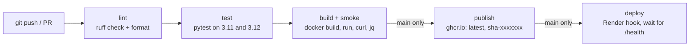

# Robot Telemetry API: CI/CD demo

<!-- Replace <user> with your GitHub username or org. -->
[](https://github.com/justinzl1/ci-cd-demo/actions/workflows/ci-cd.yml)

A small FastAPI service that stores the latest status reported by each robot. The app is
kept simple on purpose. The point of the repo is the pipeline: lint, test, build a Docker
image, smoke-test it, publish it to GHCR, and deploy it to Render on every merge to `main`.

## Architecture



On pull requests the pipeline stops after **build**. Nothing is published or deployed until
the change is merged.

## API

| Method | Path                           | Description                                              |
| ------ | ------------------------------ | -------------------------------------------------------- |
| GET    | `/health`                      | `{"status": "ok", "version": "<APP_VERSION>"}`           |
| POST   | `/robots/{robot_id}/telemetry` | Store telemetry. Returns 201, or 422 for invalid input.  |
| GET    | `/robots/{robot_id}`           | Latest telemetry for one robot, or 404.                  |
| GET    | `/robots`                      | All robot IDs with their latest state.                   |

Telemetry body:

```json
{ "battery": 87.5, "x": 1.2, "y": -3.4, "state": "moving" }
```

`battery` must be between 0 and 100, and `state` must be `idle`, `moving` or `error`. Data is
held in memory and is lost when the process restarts. Interactive docs are at `/docs`.

## Run locally

With Docker:

```bash
docker compose up --build
curl http://localhost:8000/health
```

Without Docker:

```bash
python -m venv .venv
source .venv/bin/activate      # Windows: .venv\Scripts\activate
make install                   # or: pip install -r requirements-dev.txt
uvicorn app.main:app --reload
```

Try it:

```bash
curl -X POST http://localhost:8000/robots/r2d2/telemetry \
  -H 'Content-Type: application/json' \
  -d '{"battery": 87.5, "x": 1.2, "y": -3.4, "state": "moving"}'
curl http://localhost:8000/robots/r2d2
curl http://localhost:8000/robots
```

## Run tests and lint

```bash
make test      # pytest -v
make lint      # ruff check . && ruff format --check .
make format    # auto-fix lint issues and reformat
```

Other Makefile targets: `docker-build` and `docker-run`.

## How the pipeline works

The workflow is `.github/workflows/ci-cd.yml`. It runs on pushes to `main`, pull requests
targeting `main`, and manual runs (`workflow_dispatch`). A `concurrency` group cancels an
older run when a newer commit lands on the same branch.

1. **lint**: installs the dev requirements (pip cache enabled) and runs `ruff check` and
   `ruff format --check`.
2. **test**: runs `pytest` on Python 3.11 and 3.12 in a matrix and uploads a JUnit XML
   report for each version as a build artifact.
3. **build**: builds the image with Buildx, using the GitHub Actions layer cache and baking
   `APP_VERSION=<commit sha>` into it. It then starts the container and smoke-tests it: it
   waits up to 30 s for `/health`, checks the reported version, POSTs a telemetry record,
   reads it back, and checks the response with `jq`. Any failed check fails the job.
4. **publish** (main only): logs in to GHCR with the built-in `GITHUB_TOKEN` and pushes
   `ghcr.io/<user>/ci-cd-telemetry-demo` tagged `latest` and `sha-<short sha>`.
5. **deploy** (main only, `production` environment): calls the Render deploy hook, then
   polls `PROD_URL/health` every 10 s until `version` equals the commit SHA, with a 5 minute
   limit. If the `RENDER_DEPLOY_HOOK_URL` secret is not set, it prints a notice and skips.

Dependabot (`.github/dependabot.yml`) opens weekly PRs for pip packages, the Docker base
image, and GitHub Actions versions. Those PRs go through the same pipeline.

### Docker image

The `Dockerfile` is a two-stage build on `python:3.12-slim`. The builder stage installs
`requirements.txt` into a virtualenv before any source is copied, so the dependency layer is
reused until requirements change. The runtime stage copies in the virtualenv and `app/`,
runs as a non-root `app` user, exposes port 8000, and has a `HEALTHCHECK` that calls
`/health`.

## One-time setup

1. Push this repo to GitHub and confirm the Actions run goes green. Publish and deploy will
   run too. Deploy skips with a notice until step 4 is done.
2. **Settings → Branches**: add a protection rule (or ruleset) for `main`. Require a pull
   request before merging, and require the status checks `lint`, `test` and `build` to pass.
   With the matrix, the test checks appear as `test (3.11)` and `test (3.12)`; select both.
3. **Render.com**: first make the GHCR package public (your profile → Packages →
   `ci-cd-telemetry-demo` → Package settings → Change visibility → Public). Then in Render
   choose New → Web Service → "Deploy an existing image" and enter
   `ghcr.io/<user>/ci-cd-telemetry-demo:latest`. After it is created, copy its **Deploy Hook**
   URL from the service settings.
4. **Repo Settings → Secrets and variables → Actions**:
   - Under Secrets, add `RENDER_DEPLOY_HOOK_URL` (the hook URL from step 3).
   - Under Variables, add `PROD_URL`, the Render service URL with no trailing slash, for
     example `https://ci-cd-telemetry-demo.onrender.com`.
5. **Settings → Environments**: create an environment named `production`. You can add
   required reviewers here if you want a manual approval before each deploy.

## Demo script (for screenshots)

1. **Red build blocks the merge.** On a branch, break a test, for example change the expected
   `404` in `test_get_unknown_robot_returns_404` to `200`. Open a PR. The `test` job fails,
   `build` is skipped, and the merge button is blocked by branch protection.
   *(screenshot: failed checks on the PR)*
2. **Fix and ship.** Revert the change and push. The checks go green. Merge the PR. On `main`
   the full chain runs: lint → test → build → publish → deploy.
   *(screenshot: the full job graph on the Actions run page)*
3. **Show the result.** Open the repo's **Packages** page to show the image with its
   `latest` and `sha-xxxxxxx` tags, then:

   ```bash
   curl https://<your-service>.onrender.com/health
   # {"status":"ok","version":"<the merged commit sha>"}
   ```

   *(screenshot: GHCR package page and the curl output)*

## Project layout

```
app/
  main.py            FastAPI app and routes
  models.py          Pydantic models
tests/
  test_api.py        API tests (pytest + TestClient)
.github/
  workflows/ci-cd.yml
  dependabot.yml
Dockerfile
docker-compose.yml
Makefile
pyproject.toml       ruff and pytest config
requirements.txt     runtime dependencies (pinned)
requirements-dev.txt dev and test tools
```
